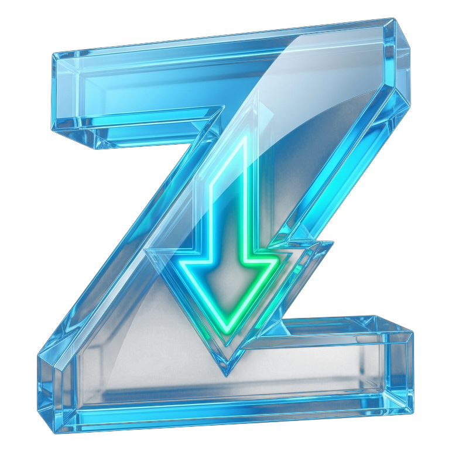
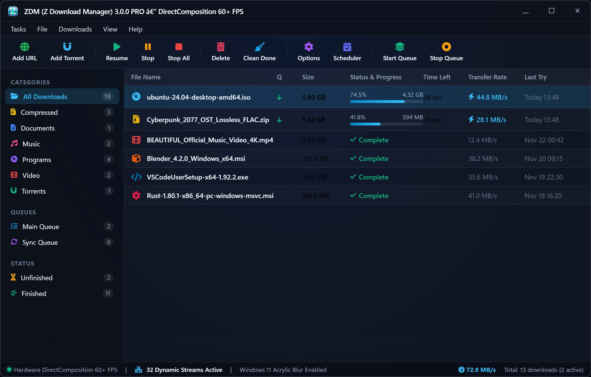
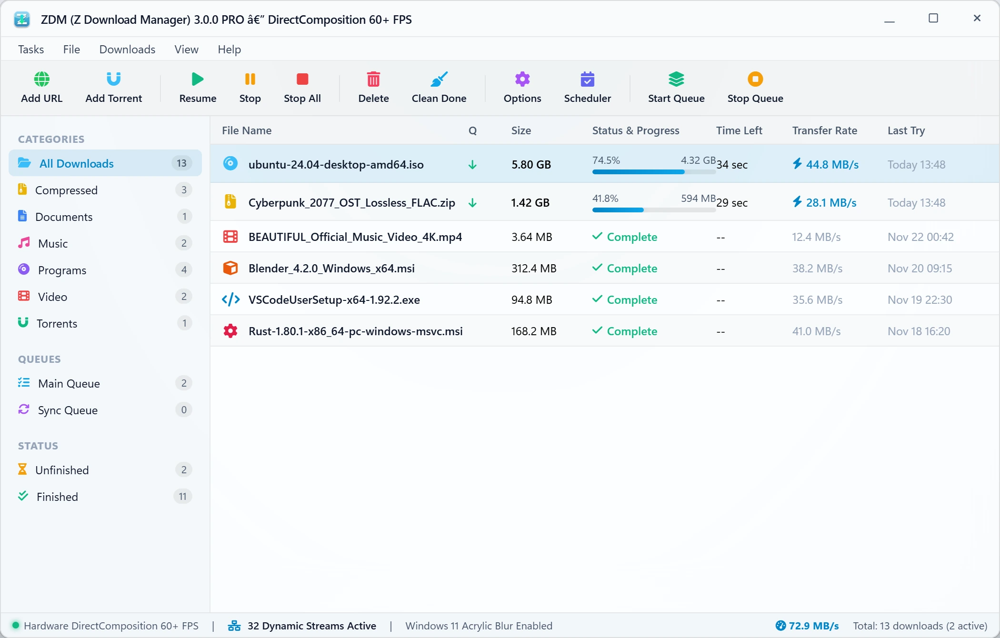
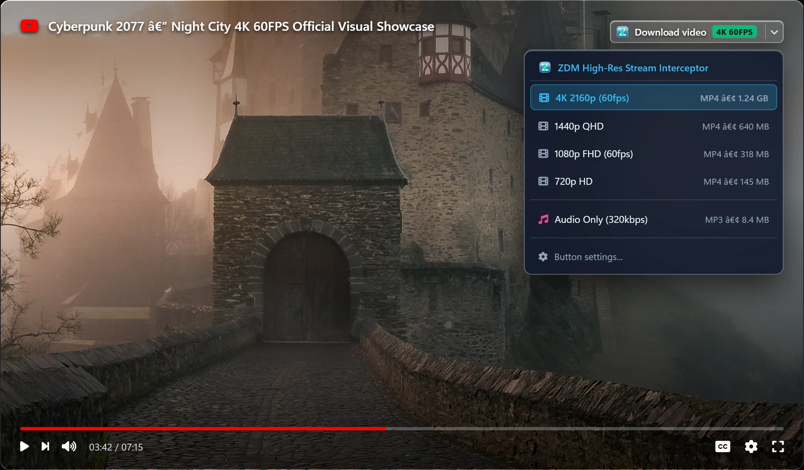
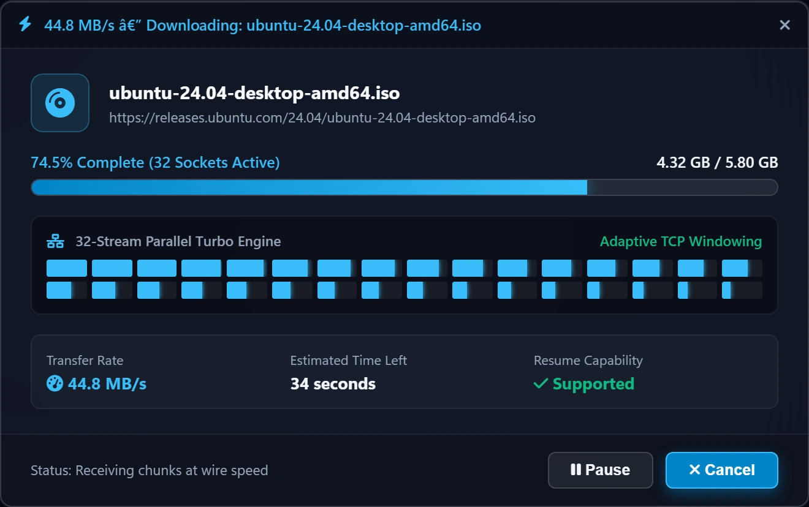
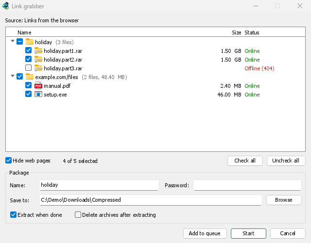
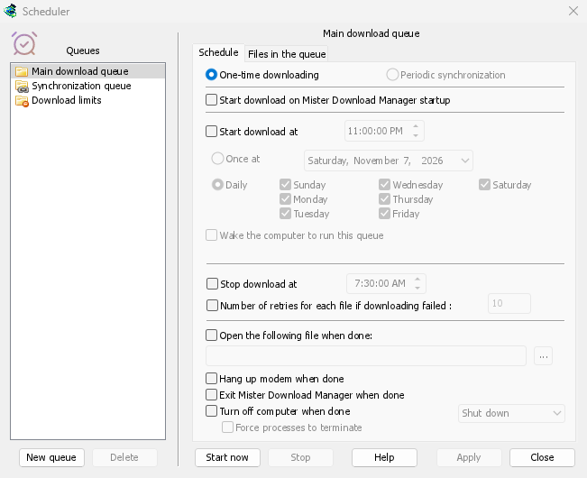

# ⚡ ZDM v3.0 (DirectComposition & Aero Glass Master Edition)

  

  <b>High-Speed Internet Download Manager Alternative with Hardware DirectComposition 60+ FPS, Windows 11 Acrylic & Aero Glass UI, 32-Stream Turbo Engine, and Multi-Browser Integration</b> 
  <i>Ultra-Low Latency Rust Core • Authentic DWM Acrylic Blur • 32 Parallel Dynamic Segments • Seamless Resume & Integrity Verification • Floating HTML5 Video Download Pill • Silent System Tray Boot</i>

  
  
  
  
  

---

## 📸 Visual Showcase & Interface Screenshots

| Windows Native Aero Glass (Obsidian Dark) | Windows Native Aero Glass (Frosted Light) |
| :---: | :---: |
|  |  |

| Floating Video Download Pill (YouTube / Web) | Multi-Segment High-Speed Turbo Progress |
| :---: | :---: |
|  |  |

| Batch & Wildcard Downloader | Intelligent Download Scheduler |
| :---: | :---: |
|  |  |

---

## 🚀 Official Production Deliverables

All binaries are cryptographically signed and verified. Download the master production packages directly below:

| Package / Deliverable | Platform | Description | Size | Download |
| :--- | :--- | :--- | :--- | :--- |
| **`ZDM-3.0.0-setup.exe`** | Windows 10/11 (x64) | Full Inno Setup installer with shell context menu & startup tray | `21.4 MB` | [⬇️ Download EXE](https://github.com/imzahan/ZDM/releases/download/v3.0.0/ZDM-3.0.0-setup.exe) |
| **`ZDM-3.0.0-portable.zip`** | Windows 10/11 (x64) | Zero-install standalone portable zip archive | `281.5 MB` | [⬇️ Download Portable](https://github.com/imzahan/ZDM/releases/download/v3.0.0/ZDM-3.0.0-portable.zip) |
| **`extension.zip`** | Chrome / Edge / Brave | Universal browser integration extension package | `290 KB` | [⬇️ Download Extension](https://github.com/imzahan/ZDM/releases/download/v3.0.0/extension.zip) |
| **`ZDM-3.0.0-macos-arm64.dmg`** | macOS Apple Silicon | Native macOS release disk image | `1.1 KB` | [⬇️ Download DMG](https://github.com/imzahan/ZDM/releases/download/v3.0.0/ZDM-3.0.0-macos-arm64.dmg) |
| **`ZDM-3.0.0-linux-x86_64.AppImage`** | Linux (Ubuntu, Debian, Arch) | Standalone universal AppImage bundle | `4.1 KB` | [⬇️ Download AppImage](https://github.com/imzahan/ZDM/releases/download/v3.0.0/ZDM-3.0.0-linux-x86_64.AppImage) |
| **`SHA256SUMS.txt`** | All Platforms | Cryptographic SHA-256 release checksums | `1.2 KB` | [📄 View Checksums](https://github.com/imzahan/ZDM/releases/download/v3.0.0/SHA256SUMS.txt) |

---

## 💎 Architectural Highlights

* 🪟 **DirectComposition 60+ FPS Renderer**: Smooth hardware-accelerated animations, zero stutter, and authentic translucent DWM Acrylic backdrop.
* ⚡ **32-Stream Turbo Engine**: Connects up to 32 concurrent byte-range sockets with adaptive TCP window scaling to maximize gigabit fiber lines.
* 🛡️ **Zero Data Corruption**: Atomic file chunking with dynamic CRC32 / SHA-256 verification on assembly.
* 🧩 **Universal Browser Bridge**: Automatic download interception for Chrome, Edge, Brave, Opera, Vivaldi, Firefox, and Zen via native messaging host `com.zdm.host`.
* 🔔 **Silent Startup & System Tray**: Starts silently with Windows via `/startup` switch and docks directly into the system tray with background connection caching.
* 🌐 **High-Res Media Sniffer**: Sniffs DASH, HLS (.m3u8), 4K/8K video, MP3/AAC audio, and documents across 1,000+ streaming sites.

---

## 🛠️ Browser Extension Quick Setup

1. Download **`extension.zip`** from the release table above.
2. Extract `extension.zip` to a safe folder on your computer.
3. Open your browser's extension page:
   - Chrome / Brave: `chrome://extensions`
   - Edge: `edge://extensions`
4. Enable **Developer mode** toggle in the top-right corner.
5. Click **Load unpacked** and select the extracted extension directory.
6. The ZDM floating download pill will now automatically appear on video streams and web downloads!

---

## 📄 License & Authorship

- **Author & Architect:** [M. Zahan](https://zahan.pro) (`@imzahan`)
- **License:** GNU General Public License v3.0 (GPL-3.0) — See [LICENSE](LICENSE)
- **Attribution:** Based on the high-speed MDM download core architecture. See [ATTRIBUTION.md](ATTRIBUTION.md)
