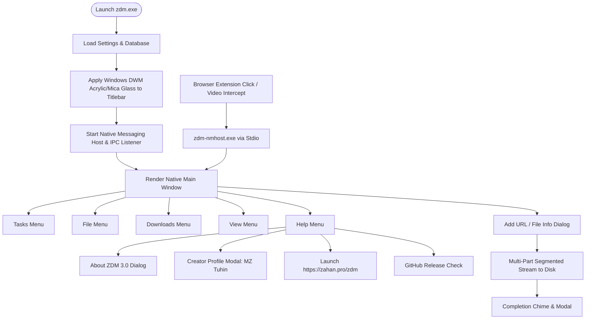

# ZDM (Z Download Manager) 3.0 - Application Flow & State Machine (appflow.md)

**Document Status**: LOCKED & MANDATORY  
**Target Architecture**: `V3/` Clean Native Architecture  
**Author & Publisher**: MZ Tuhin (M. Zahan) &bull; [https://zahan.pro/zdm](https://zahan.pro/zdm)  

---

## 1. Master Application Flowchart

---

## 2. Menu Navigation Architecture

### Tasks
- Add new download... (`Ctrl+N`)
- Add batch download...
- Add batch download from clipboard (`Ctrl+V`)
- Add torrent / magnet...
- Show floating drop target
- Export / Import downloads
- Exit (`Alt+F4`)

### File
- Stop download
- Resume download
- Redownload
- Delete (`Del`)
- Delete completed
- Open file / Open folder
- Properties...

### Downloads
- Pause all / Resume all
- Speed limiter (On/Off/Configure)
- Scheduler...
- Options... (12 Tabs)

### View
- Toolbars, Status bar, Category tree toggles
- Column customization
- Interface themes (Light, Dark, Classic, Custom)

### Help
- Help Topics & Online Documentation -> Opens `https://zahan.pro/zdm`
- Creator Profile & Contact -> Opens MZ Tuhin (M. Zahan) Verified Creator Dialog
- About ZDM (Z Download Manager)... -> Opens About ZDM 3.0 with Verified Creator Badge
- Check for Updates... -> Queries `https://api.github.com/repos/assassinzahan-gif/ZDM/releases/latest`
- Keyboard Shortcuts...
- Tell a Friend...

---

## 3. Verified Creator Profile Modal Flow

Triggered from **Help &rarr; Creator Profile & Contact** or **Help &rarr; About ZDM &rarr; Creator Card**:
1. Renders high-res avatar of MZ Tuhin (`mz_avatar.png`).
2. Displays Name: `MZ Tuhin (M. Zahan)` with Blue Circle Verified Badge `[✓ Verified]`.
3. Displays Role: `UI/UX Designer • Full Stack Developer`.
4. Displays Official Bio and Interactive Social Links:
   - Website: `https://zahan.pro`
   - WhatsApp: `https://wa.me/8801716221110`
   - Telegram: `https://t.me/mzahanit`
   - Facebook: `https://facebook.com/mz.tuhin`
   - Email: `assassinzahan@gmail.com`
   - Location: `Khulna, Bangladesh`
